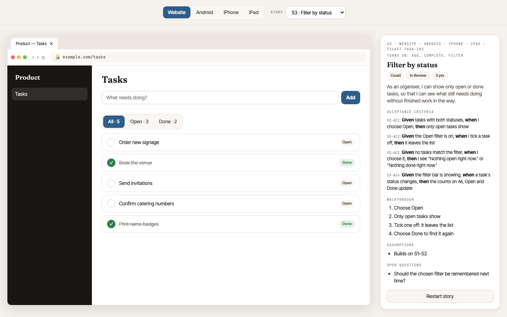
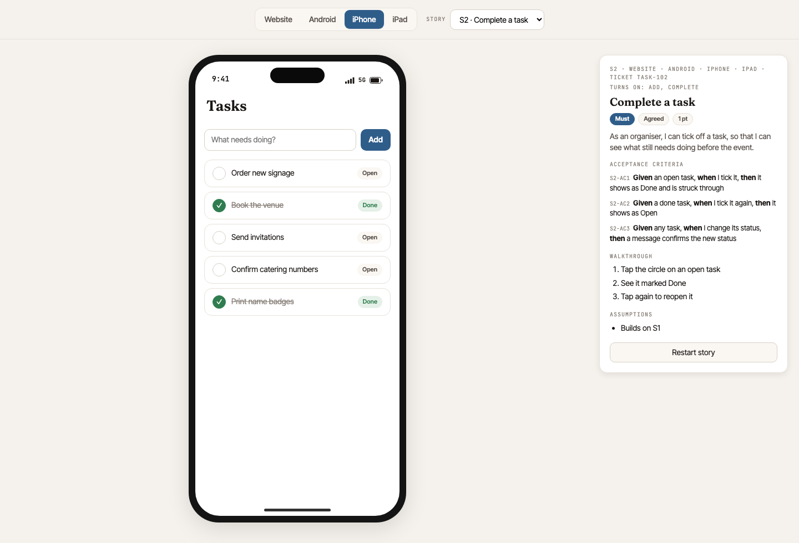

# design-by-story

A Claude Skill that builds a single-file, clickable HTML prototype of a product, viewable
on several devices (Website · Android · iPhone · iPad) and **broken down by user story**.



Pick a device and a story from the top bar. The prototype then:

- resets to that story's data;
- opens each device on the story's start screen;
- shows the story alongside: priority, status, story points, tracker ticket, acceptance
  criteria (with IDs, in Given/When/Then), a walkthrough and notes.

Stories build up in the order they'll be built: each story shows only what it and the
stories before it add, so reviewers never see a later story's controls, labels or
screens early. "All stories" shows the whole product.

Links like `prototype.html#story=S2&device=iphone` open straight to a story on a device.
For hosts that only keep plain `#name` links, the shell can write `#story-S2--iphone`
instead.



The prototype shows stories but never edits them. To add, change, move or split a
story, ask Claude. Claude can also:

- read stories from a tracker (Jira, Azure DevOps or similar) and, with your go-ahead,
  write changes back, with a link to each story in the prototype;
- match your existing designs (screenshots, Figma frames or a design system) instead
  of its own default look.

## Install

In Claude Code:

```
/plugin install design-by-story --marketplace rinkledink/design-by-story-skill
```

Or copy the skill in by hand:

```sh
cp -r skills/design-by-story ~/.claude/skills/
```

Then ask Claude for a prototype, e.g. *"Prototype my app by story — here are the stories…"*.

## Contents

- `skills/design-by-story/SKILL.md`: workflow, story format, AC rules and how to split stories
- `skills/design-by-story/references/prototype-spec.md`: frames, tokens, type, components
- `skills/design-by-story/assets/shell.html`: working template with five example stories (open it to try)
- `.claude-plugin/`: plugin and marketplace manifests
